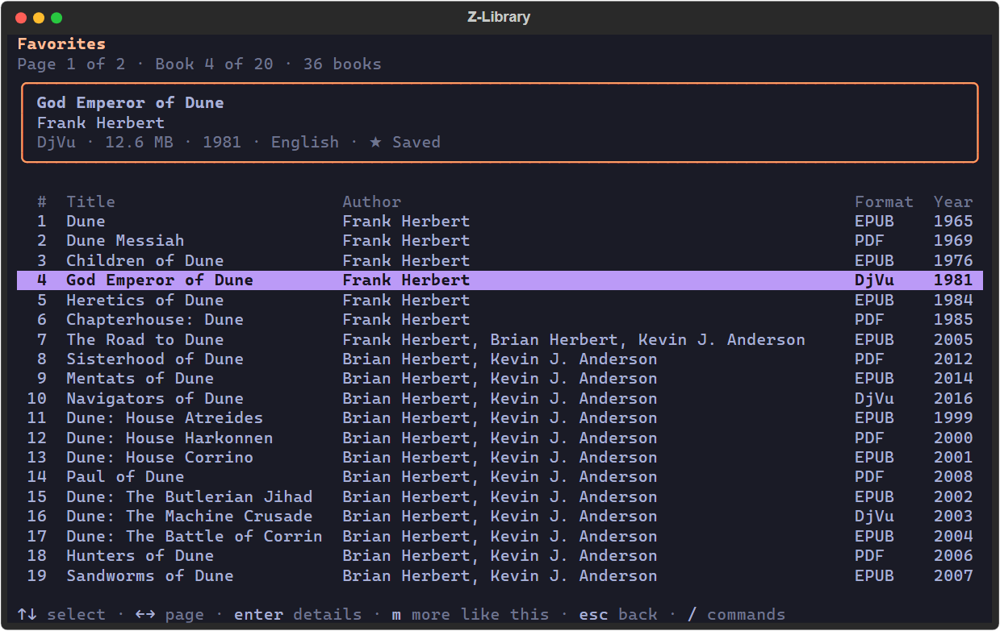

# Zlibrary API

An unofficial Z-Library client: the `zlib-cli` command-line tool, a local HTTP API, an MCP server
for AI assistants, an optional terminal interface and a Python library (package `zlib-connector`,
import `zlib_connector`). Find books, download one or a whole reading list, and manage your
favorites, booklists and tags.

> **Unofficial client.** This project is not affiliated with Z-Library. It relies on unofficial
> interfaces that can change or break without notice, and which domains work depends on your
> network and the day.

## Quick start

You need Python 3.11 or later; Windows and Linux are tested, macOS is not. Downloads need a
Z-Library account.

1. Install `zlib-cli` in a virtual environment. In each new terminal, run the activation line (the
   fourth) again from the project folder.

   Windows (PowerShell):

   ```powershell
   git clone https://github.com/nassim-arifette/zlibrary-api.git
   cd zlibrary-api
   python -m venv .venv
   .venv\Scripts\Activate.ps1
   python -m pip install -e .
   ```

   Linux (bash):

   ```bash
   git clone https://github.com/nassim-arifette/zlibrary-api.git
   cd zlibrary-api
   python3 -m venv .venv
   source .venv/bin/activate
   python -m pip install -e .
   ```

2. Find a domain that works from your network. `doctor` tries a real search on each known domain,
   without signing in, and ends with `Suggested domain: ...`.

   ```sh
   zlib-cli --timeout 5 doctor
   ```

3. Sign in on that domain (replace `https://z-lib.by/`). You are asked for your email and password;
   the password stays hidden. The session is saved, and later commands reuse it and its domain.

   ```sh
   zlib-cli --domain https://z-lib.by/ login
   ```

4. Search, download and check your quota. Each search result ends with its reference, `ID:HASH`.
   `download` lists the matches and asks which one to save in the current folder;
   `zlib-cli download ID:HASH` takes one exact edition instead. `quota` shows how many downloads you
   have left today: every download counts against this daily limit.

   ```sh
   zlib-cli search "Pride and Prejudice" --format epub --limit 5
   zlib-cli download "Pride and Prejudice" --format epub
   zlib-cli quota
   ```

Global options such as `--domain`, `--timeout` and `--json` work before or after the command name.

## Find books

```sh
zlib-cli search "history" --language french --year-from 2000 --order popular --page 2
zlib-cli info ID:HASH
zlib-cli formats ID:HASH
zlib-cli similar ID:HASH
zlib-cli popular
zlib-cli recommended
```

- `search` takes a title, author or ISBN. Repeat `--format` (pdf, epub, djvu) or `--language` to
  accept several values. `--year-from`, `--year-to` and `--order` narrow and sort the results.
  `--limit` sets the page size (default 20, up to 50) and `--page` moves between pages.
- `ID:HASH` is the reference printed after each result, such as `123:ab12`; the book's URL on the
  same domain works too. `info` shows the book's details, and `formats` lists its other formats,
  each with its own reference.
- `similar`, `popular` and `recommended` show Z-Library's suggestions.
- `--anonymous` (on `search`, `info`, `formats`, `similar` and `popular`) works without your
  account. It uses `--domain`, or `https://z-lib.by/` by default, never your saved domain.

## Download books

### One book

```sh
mkdir books
zlib-cli download "Emma" --format epub --language english --output books
zlib-cli download ID:HASH --output books
```

A title, author or ISBN is searched with the filters of `search`, and you choose a result
(`--pick N` chooses without asking). A reference downloads that edition directly. `--output` must be
an existing folder; the default is the current one. PDF, EPUB and DjVu files up to 256 MiB are
supported. In a terminal, progress shows on stderr; the global `--progress` and `--no-progress`
force it on or off, and `--quiet` hides notes and progress but keeps data and errors.

Ctrl+C cancels and removes the partial file, and a book is saved only after its file is checked.
Downloads are never retried automatically and cannot be resumed. Once the download link was
requested, a download can count against your quota even if it fails or you cancel it.

`zlib-cli shell` signs in once, then takes `search "QUERY" [filters]` (quote the query when you add
filters), `next`, `prev`, `download NUMBER [FOLDER]` for the last page shown, and `quit`. It also
accepts the global `--progress`, `--no-progress` and `--quiet`.

### A reading list

```sh
zlib-cli download "Dune" "Neuromancer" "Foundation" --format epub --output books
zlib-cli download -a reading-list.txt --output books
```

Give several titles, ISBNs or references, or a list with `-a` (up to 1000 items):

- text: one title, author, ISBN, reference or book URL per line; blank lines and lines starting with
  `#` are skipped;
- CSV or TSV: a header with a `title`, `query`, `isbn` or `reference` column, plus `author` if you
  like; other columns, such as the extra ones in Goodreads, StoryGraph or Calibre exports, are
  ignored;
- JSON, such as the `--json` output of `search`, `favorites` or `booklists show`, whose exact
  editions are downloaded without a new search.

In a terminal, each search shows up to five candidates (`--limit`, up to 50) and asks you to choose
one, skip (`s`) or stop (`q`); the command never chooses for you. A book listed twice is downloaded
once. You then confirm the plan, which shows your quota when it is known. Without a terminal, pass
`--pick N --yes`: `--pick N` takes result N of every search without checking that it is the right
edition, so review the plan first. Press Ctrl+C once to stop after the current book, twice to also
cancel that download (its quota may already be used), and three times to stop at once.

### Finish a list later

The quota is checked before each book. When it runs out, the other books wait: run the same command
again after it renews. `reading-list.progress.json`, next to the list, remembers finished books,
choices and skips. It records books by file name, so keep the same `--output` folder. Titles given
on the command line get a progress file only with `--report FILE`. `--max-downloads N` keeps some
quota for later.

A download that fails after its link was requested may have used quota, so it is never retried
automatically, in this run or later ones. Check the folder and `zlib-cli history`, then run the same
command once with `--retry-uncertain`.

### Review the plan first

```sh
zlib-cli download -a reading-list.txt --dry-run --json > plan.json
zlib-cli download -a plan.json --report reading-list.progress.json --yes --output books
```

`--dry-run` chooses editions without downloading anything. In `plan.json`, set `"pick": 2` or a
`"reference"` for items that still need a choice. Downloading a plan needs `--report FILE`, with the
list's progress file so that later runs of the list know about it, or `--no-report`. The
[reference](docs/reference.md#batch-downloads) covers every list format, option and status.

## Manage your favorites, booklists and tags

```sh
zlib-cli library
zlib-cli history --page 2
zlib-cli favorites add ID:HASH
zlib-cli booklists show BOOKLIST_ID
zlib-cli booklists add BOOKLIST_ID ID:HASH
zlib-cli booklists remove BOOKLIST_ID ENTRY_ID
zlib-cli booklists create "Science" --description "Books to explore"
zlib-cli booklists edit BOOKLIST_ID --title "Science and nature" --public
zlib-cli tags add ID:HASH "To read" "Science"
```

- `library` previews your favorites, download history and booklists; `favorites` and `history` list
  them page by page. `history` is Z-Library's record of your downloads, not a list of files on this
  computer. Books in your favorites are marked `[saved]` when that is known.
- `favorites add` and `favorites remove` take a reference, or `-` (stdin) or `-a FILE` for a list of
  references: the `--json` output of `search`, `favorites` or `booklists show` works. `booklists add`
  and `tags add/remove` take lists the same way. Lists need `--yes` and report each book's status.
- `booklists` shows each list with its ID first. `ENTRY_ID` is the `Booklist entry` number that
  `booklists show` prints under each book; it is not the book ID. New lists are private unless you
  pass `--public`, `edit` changes only what you pass, and `booklists delete` is permanent.
- `tags` lists your My Library tags. `tags add` also adds the book to your favorites, and
  `tags remove` keeps it there. Labels are case-sensitive: quote labels with spaces, and copy
  existing ones from `tags`.
- Every change shows what it will do (book title, booklist title and size, domain) and asks `[y/N]`;
  scripts pass `--yes`, and `--dry-run` shows the change without sending it. Changes are never
  retried automatically: if a connection problem leaves one unconfirmed, check before retrying.

## Browse in the terminal

An optional terminal interface lets you search the catalog with filters, see popular, recommended
and similar books, browse your favorites, booklists and download history, and download a book with
`d`. It does not change your account. One command is enough:

```sh
python -m pip install -e ".[tui]"
zlib-cli tui
```

The interface uses your saved session (run `zlib-cli login` once, or it asks for your email and
password). If a `zlib-cli serve` is already running, it uses that server; otherwise it starts a
private one for the session and stops it when you quit.

`d` on a book asks for confirmation, then downloads it into your `download_dir` setting (else your
Downloads folder) and shows the progress at the bottom; `x` cancels. Each confirmation is one
download from your daily allowance, and a failed download is never retried on its own. With your
own `zlib-cli serve`, downloads work too unless you started it with `--no-downloads`.



It opens on Home. Press `s` to search, `/` for the list of commands, Enter to open a book, `m` for
more like it, Esc to go back, `?` for help and `q` to quit. The [TUI guide](docs/tui.md) covers every
page, key and option.

## Sign-in and privacy

```sh
zlib-cli login
zlib-cli status --verify
zlib-cli logout
```

- `login` asks for your email and password, or reads the credentials file below; they are never
  command-line options. It saves only the session cookies, never your email or password.
- Account commands, `serve` included, reuse the saved session and its domain; if it expired, run
  `login` again. Without a saved session, or with `--no-session`, they ask for your email and
  password (or read the credentials file) and sign in for that run only; only `login` saves.
- A session belongs to one domain. To switch, run `zlib-cli --domain URL login`.
- `status` checks the saved session without connecting; `--verify` asks Z-Library. `logout` forgets
  it on this computer only: it does not sign you out on Z-Library or stop a running `shell` or
  `serve`.
- `--anonymous` commands and `doctor` never read your session or credentials.
- The session and the API token are stored in `%LOCALAPPDATA%\zlibrary-api` on Windows and in
  `~/.local/state/zlibrary-api` elsewhere (`$XDG_STATE_HOME/zlibrary-api` when it is set);
  `ZLIB_STATE_DIR` overrides both, and `--session-file PATH` picks another session file. These files
  have private permissions but are not encrypted: keep them, and any copies, out of Git and shared
  folders.

To skip typing your email, copy `credentials.example.toml` to `credentials.toml` in the settings
folder (`zlib-cli config path` prints the settings file; the credentials file goes beside it) and
fill it in. Leave `password` empty to be asked each time: a password written here is stored in plain
text. Commands never print credentials or session cookies. `--credentials PATH`, `ZLIB_CREDENTIALS`
or `zlib-cli config set credentials_file PATH` name another file. The older `credentials.local.toml`
in the project folder still works; commands that read it print a one-line note suggesting the move.

```toml
domain = "https://z-lib.by/"
email = "you@example.com"
password = ""
```

## Save your preferences

```sh
zlib-cli config set domain https://z-lib.by/
zlib-cli config set formats epub
zlib-cli config set download_dir ~/Books
zlib-cli config list --show-origin
zlib-cli config unset formats
```

`config set` saves a setting in `config.toml`: `%APPDATA%\zlibrary-api` on Windows,
`~/.config/zlibrary-api` elsewhere (`$XDG_CONFIG_HOME/zlibrary-api` when it is set). The keys are
`domain`, `timeout`, `download_dir`, `languages`, `formats`, `api_url`, `credentials_file`,
`progress` (`auto`, `always` or `never`) and `proxy`. No
email, password, cookie or token is ever stored there.

- An option given on the command line wins, then a `ZLIB_*` variable (`ZLIB_DOMAIN`, `ZLIB_TIMEOUT`,
  `ZLIB_DOWNLOAD_DIR`, `ZLIB_LANGUAGES`, `ZLIB_FORMATS`, `ZLIB_API_URL`, `ZLIB_CREDENTIALS`,
  `ZLIB_PROGRESS`, `ZLIB_PROXY`; lists are
  comma-separated), then the file. `--no-config` ignores the file for one run, and `--config FILE`
  (or `ZLIB_CONFIG`) uses another file.
- Saved formats and languages filter searches only, and each search says so on stderr; `--format`
  and `--language` replace them. They never apply to an `ID:HASH` reference and never choose a book.
- `proxy` (`http://HOST:PORT`, or `--proxy URL` for one run) sends the site's traffic through an HTTPS
  proxy with HTTP CONNECT; TLS still runs end to end to the site. `--no-proxy` connects directly.
  `HTTP_PROXY` and `HTTPS_PROXY` are ignored, and `jobs`, `queue` and `tui` always talk to the local API
  directly. `doctor` says which proxy it went through.
- `download_dir` is the default `--output` of `download` and `jobs file`. `serve --downloads` keeps
  the download queue's tasks there instead of in the state folder.
- A saved `domain` is used instead of the saved session's domain. When they differ, account commands
  stop and say which setting chose the domain; run `zlib-cli login` there, or change the setting.
  `doctor` still probes every known domain and says how to save the one it suggests.
- `api_url` is where `jobs` and `tui` find the server, and where `serve` listens unless you pass
  `--host` or `--port`. The MCP server uses the saved `domain` and `timeout` too.

The [technical reference](docs/reference.md#settings) has every rule.

## Shell completion

`zlib-cli completion SHELL` prints a completion script; add the line for your shell yourself, the CLI never
edits a profile:

| Shell | Line to add |
|---|---|
| bash | `eval "$(zlib-cli completion bash)"` in `~/.bashrc` |
| zsh | `eval "$(zlib-cli completion zsh)"` in `~/.zshrc`, after `compinit` |
| fish | `zlib-cli completion fish > ~/.config/fish/completions/zlib-cli.fish` |
| PowerShell | `zlib-cli completion powershell \| Out-String \| Invoke-Expression` in `$PROFILE` |

Tab completes commands, actions, options, formats, orders, views, domains and `config` keys and values, and
falls back to file names for path options. It works offline and never reads your settings, session or
credentials. It needs the installed `zlib-cli` (`python -m pip install -e .`), not `python -m`.

## Use it in scripts

- Results go to stdout; prompts, progress and errors go to stderr. `--json` gives JSON results and
  errors on every command that prints results except `shell`, `serve` and `tui`; `check` and
  `auth-test` always print JSON. Both are deprecated and hidden from help: use `doctor DOMAIN`, and
  `login` then `status --verify`.
- `zlib-cli --help` groups the commands, and `zlib-cli COMMAND --help` ends with examples. Text tables
  print one line per book and never shorten an `ID:HASH` reference; text output may change, so
  scripts should use `--json`.
- Without a terminal, account changes need `--yes`. For one book, pass `--pick N` or a reference so
  that nothing asks. Any list option, even `--yes`, makes `download` a list run, which needs `--yes`
  (except with `--dry-run`) and, for searched items, `--pick N`. A list run prints one line per book
  and a summary, or one report object with `--json`.
- Nothing asks a question without a terminal: prompts need stdin and stderr to be terminals, or
  `--interactive` to read answers from stdin. `--no-input` (or `ZLIB_NO_INPUT=1`) turns them off
  everywhere. When an answer would be needed, the command stops before any request and says which
  option to add. Passwords are only read from a terminal: run `zlib-cli login` there once.
- Exit codes: 0 success, 1 failed, 2 invalid command line or missing input, 3 try again later (rate
  limit, quota, network), 4 check before trying again (an account change or download may have
  happened), 5 sign in first, 130 cancelled. `doctor` returns 1 when no domain works, and `jobs
  watch` returns 0 only when the task succeeded. List runs also return 3 when books only wait
  (quota, `--max-downloads` or a temporary failure: run the same command later) and 4 when an item
  needs attention (not found, error, uncertain download or missing choice).
- With `--json`, every error is one JSON object on stderr with a stable `code`, `exit_code`,
  `retryable` and `outcome`, and JSON is always ASCII. [CLI output for scripts](docs/cli-json.md)
  lists the shapes and codes, and how scripts written for earlier versions should adapt.
- In PowerShell, check `$LASTEXITCODE`, and pass lists with `-a FILE` instead of piping them into
  `-a -`. Reading a list from standard input needs a saved session or an email in the credentials
  file.
- Large files may need a longer `--timeout`, up to 300 seconds (`zlib-cli config set timeout 120`
  keeps it).
- Saved settings and `ZLIB_*` variables apply to scripts too: pass `--no-config` for a run that must
  ignore the file. A bad setting stops a command before any request with the `config_invalid` code
  (exit 2), naming the key and where it came from.

## Local HTTP API

```sh
zlib-cli serve
```

`serve` uses your saved session, or signs you in for this run only, and serves the API at
`http://127.0.0.1:8000/v1` until you press Ctrl+C. `--port` picks another port, and `--anonymous`
serves public search and book details without your account. Every request needs the bearer token
from the file whose path `serve` prints; keep that file private, as it gives access to your account
through the server. Only local connections are accepted, browsers only from origins you allow with
`--allow-origin`, and account changes apply at once, without a confirmation. The
[HTTP API guide](docs/http-api.md) lists the routes and errors and has a Python example.

### Download queue

```sh
zlib-cli serve
# in a second terminal:
zlib-cli jobs add ID:HASH --key dune-epub-001
zlib-cli jobs list
zlib-cli jobs watch 0123456789abcdef0123456789abcdef
zlib-cli jobs file 0123456789abcdef0123456789abcdef --output books
zlib-cli queue add -a reading-list.json --key reading
```

A signed-in server accepts downloads by default and keeps its tasks in the state folder
(`--download-dir DIR` chooses another folder, `--no-downloads` turns the queue off; an `--anonymous`
server has none). Nothing is downloaded until a client asks for a book. The server downloads queued
books one at a time. `--key` is required and names the request: sending
the same key and book again returns the same task instead of a second download. `jobs add` and
`jobs list` print each task's 32-character ID, which `show`, `watch`, `cancel` and `file` take (the
ID above is an example). `jobs file` copies a finished book without downloading it again. When the
quota runs out, the queue pauses until you run `zlib-cli jobs resume`. `queue add` submits a list of
exact references (arguments, `-` for stdin or `-a FILE`, such as the `--json` output of `search`) as one
task per book, with keys `PREFIX-0001`, `PREFIX-0002`...; running it again replays the same tasks. For
scripts, `serve --json` prints one line with the URL and token file once it listens. Stopping the server
interrupts the current download, which is not retried. See the
[download task guide](docs/download-tasks.md).

## Use it from an AI assistant (MCP)

```sh
claude mcp add --transport stdio --scope user zlib -- zlib-cli mcp
codex mcp add zlib -- zlib-cli mcp
```

`zlib-cli mcp` lets Claude Code, Claude Desktop or Codex search books and read your favorites, history,
booklists and quota, using the session saved by `login`. It is read-only by default: `--download-dir DIR`
adds downloads into that folder and `--allow-account-changes` adds favorite, tag and booklist changes, and the
assistant asks you before each of these calls (`--no-download-confirmation` stops asking for downloads only).
Downloads take one exact edition and are never retried automatically. The [MCP guide](docs/mcp.md) covers registration for each client, the tools and the safeguards.

## Python library

```python
from zlib_connector import Client, SearchFilters

filters = SearchFilters(languages=("english",), formats=("epub",))

with Client("https://z-lib.by/") as client:
    page = client.search_page("Pride and Prejudice", filters=filters, limit=5)
    for book in page.books:
        print(f"{book.book_id}:{book.book_hash}  {book.title}")
```

The library also covers sign-in and saved sessions, book details and formats, quota, downloads with
progress and cancellation, reading lists, account collections and domain checks. The
[reference](docs/reference.md#python-api) has examples, return types and errors.

## Troubleshooting

| What you see | What to try |
| --- | --- |
| `zlib-cli` is not found | Activate the virtual environment ([Quick start](#quick-start), step 1), or run `python -m zlib_connector` from the project folder. |
| PowerShell refuses to run `Activate.ps1` | Run `Set-ExecutionPolicy -Scope Process -ExecutionPolicy RemoteSigned` (for that window only), then activate again. |
| `Use --yes ...`, `... needs a terminal` or `No saved session, and no terminal to sign in.` | Without a terminal nothing is asked: add the option the message names (`--yes`, `--pick N`), run `zlib-cli login` in a terminal first, or add `--interactive` to answer from standard input. |
| A domain is blocked, stops responding or asks for browser verification | Run `doctor` again, then `zlib-cli --domain URL login` on a working domain. This client cannot complete browser verification. |
| Login fails | Check the domain, email and password; `login` then `status --verify` tests them. Repeated logins do not fix a blocked domain. |
| `The saved session belongs to another domain` | The message names what chose the domain (`--domain`, `ZLIB_DOMAIN`, the config file or the credentials file). Drop or change it, or run `login` on the new domain. |
| The saved session expired or is refused | Run `login` again on the same domain. A temporary network failure leaves the session intact. |
| Another process changed the saved session | Check `status` before repeating `login` or `logout`. |
| No downloads remaining | Check `quota` and wait until your daily limit renews. |
| A list item may have used quota | Check the folder and `zlib-cli history`, then run once with `--retry-uncertain`. |
| A book cannot be saved | Use an existing, writable folder with free space on a drive with hard links: NTFS and common Linux file systems work, FAT32 and exFAT (many USB sticks and SD cards) do not. Very long Windows folder paths can also fail. |
| The terminal interface cannot connect | Start a signed-in `zlib-cli serve` first, then see [TUI troubleshooting](docs/tui.md#troubleshooting). |

Run `zlib-cli --help`, or add `--help` after any command, to see every option.

## Status and roadmap

Version 0.1.0: everything described above works today. Planned, without dates:

- Booklists: moving books between lists, import and export, browsing public lists.
- Reading lists through the HTTP API and the terminal interface (today: CLI and Python only).
- In the terminal interface: collection editing, downloads, account views and live download-task
  updates (today it searches and browses).
- The website's full My Library page, browsable and searchable by tag.
- HTTP login and logout, a live feed for the whole download queue, resuming partial downloads.
- In the MCP server: downloads that outlive the assistant by
  sharing a running `zlib-cli serve` queue.
- Uploads, once Z-Library's upload flow has been checked.

Not supported: formats other than PDF, EPUB and DjVu, files over 256 MiB, browser verification, HTTP
API connections from other machines, paging or filters for `popular`, `similar` and `recommended`, a
recent-additions view (Z-Library's endpoint returns no list; use `search QUERY --order date`), and deleting download tasks or importing a booklist into the queue.

## Documentation

- [Technical reference](docs/reference.md): CLI rules in detail, the Python API, list and
  progress-file formats, safeguards.
- [HTTP API](docs/http-api.md), [download tasks](docs/download-tasks.md), the
  [MCP server](docs/mcp.md) and the [terminal interface](docs/tui.md).

## Development

The core package has no runtime dependencies; the terminal interface uses Textual. Without that
extra, its tests are skipped.

```sh
python -m pip install -e ".[tui]"
python -m unittest discover -s tests -q
```

The tests are offline: they use synthetic accounts and never contact Z-Library. GitHub Actions runs
them, with the extra, on Windows and Linux with Python 3.11 and 3.14, and checks the installed
`zlib-cli` outside the source folder. CI runs for pull requests that change code, tests, packaging
or the workflow (a newer push cancels the older run) and on demand. Documentation-only changes skip
it, and merges do not rerun it on `main`.
